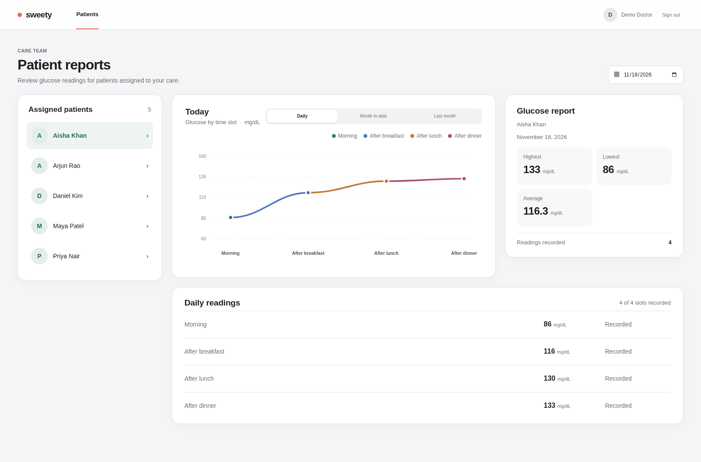
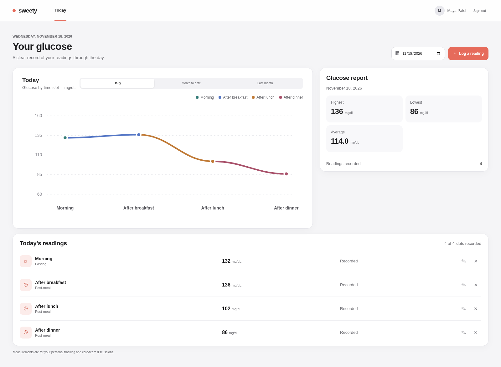

# Sweety — Blood Glucose Tracker

Sweety is a small React + Express + PostgreSQL app for recording up to four blood glucose readings per day and reviewing daily and monthly summaries. It includes account signup/login and keeps each user's readings private to their account.

## Requirements

- Node.js 20 or newer
- PostgreSQL 14 or newer

## Install and setup

Requirements: Node.js 20+, npm, and PostgreSQL 14+.

1. Create a local database:

   ```sh
   createdb sweety
   ```

   The PostgreSQL role used by the app needs permission to create tables and the `pgcrypto` extension. The API creates the extension and tables at startup.

2. Create your local environment file:

   ```sh
   cp .env.example .env
   ```

   Set `DATABASE_URL` to match your local PostgreSQL credentials and replace `JWT_SECRET` with a long random value (for example, `openssl rand -base64 32`). `.env` is ignored by Git; `.env.example` contains placeholders only.

3. Install dependencies and seed the demo accounts:

   ```sh
   npm install
   npm run db:seed
   ```

## Run the app

Start the API and frontend in separate terminals from the project root:

```sh
# Terminal 1: Express API at http://localhost:4000
npm run dev:server
```

```sh
# Terminal 2: Vite client at http://localhost:5173
npm run dev:client
```

Or run both together with `npm run dev`. Open [http://localhost:5173](http://localhost:5173).

The optional reminder worker requires Redis. Set `REDIS_URL`, then run `npm run worker` in another terminal. Redis caching is also optional; without `REDIS_URL`, reports are served directly from PostgreSQL.

## Demo account

To seed the demo doctor and five sample patient accounts:

```sh
npm run db:seed
```

- Email: `demo@sweety.local`
- Password: `SweetyDemo123!`
- Other patient emails: `arjun.rao@sweety.local`, `priya.nair@sweety.local`, `daniel.kim@sweety.local`, `aisha.khan@sweety.local`
- All patient accounts use password: `SweetyDemo123!`
- Doctor email: `doctor@sweety.local`
- Doctor password: `SweetyDoctor123!`

The doctor is assigned to all five patients: Maya Patel, Arjun Rao, Priya Nair, Daniel Kim, and Aisha Khan. Each account receives 60 days of synthetic readings across four daily time slots. Re-running the seed replaces readings only for these five sample accounts and preserves readings for other patients.

## Docker Compose

Copy `.env.example` to `.env`, set a private `JWT_SECRET` and a local `POSTGRES_PASSWORD`, then build and start the development app with PostgreSQL and Redis:

```sh
docker compose up --build
```

Open [http://localhost:5173](http://localhost:5173). Compose keeps PostgreSQL data in the `sweety_data` volume. Report results are cached for one minute and invalidated when a reading is created, edited, or deleted. At 22:00 in `REMINDER_TIMEZONE` (Asia/Kolkata by default), a worker logs accounts with fewer than four readings for that day, allowing time for the after-dinner reading. Stop the services with `docker compose down`; use `docker compose down -v` only when you also want to delete the database volume.

## Features

- Register with name, email, and password; passwords are hashed with bcrypt before storage.
- Log in and access only readings associated with the signed-in account.
- Add, view, edit, and delete dated readings for Morning (fasting), After breakfast, After lunch, and After dinner.
- Validate required values, whole-number range (40–600 mg/dL), one reading per slot/day, four readings/day, and no future dates.
- View highest, lowest, average (one decimal), and reading count for a selected day, month to date, or the whole previous month.
- Browse readings with server-side pagination and filter them to one date when needed.
- Explore daily and monthly readings in a slot-colored line chart.
- Cache report responses in Redis and clear a user's cached ranges when their readings change.
- Run a BullMQ daily job that logs accounts with fewer than four readings; it does not send messages.
- Give doctors read-only access to reports for patients assigned to them.
- Show a friendly empty state when a report has no readings.

## Project structure

- `client/src/pages/`: authentication, patient, and doctor screens.
- `client/src/components/`: chart, reading dialog, reading row, and report stats.
- `client/src/constants/`: shared reading slots and chart colors.
- `server/routers/`: API paths and authentication/authorization middleware wiring.
- `server/controllers/`: request validation, database operations, and HTTP responses by API area.
- `server/services/`: report range calculations and report building shared by patient and doctor APIs.
- `server/middlewares/`: session verification, doctor authorization, and error responses.
- `server/config/`: PostgreSQL and optional Redis connections.
- `server/validators/` and `server/utils/`: reading validation, token creation, and shared helpers.

`server/app.js` assembles Express; `server/index.js` initializes dependencies and starts it. Existing development, seed, and worker commands are unchanged. Backend route tests stub database calls; they do not require PostgreSQL or Redis.

## API overview

All reading and report endpoints require `Authorization: Bearer <token>`.

| Method | Endpoint | Purpose |
| --- | --- | --- |
| POST | `/api/auth/signup` | Create an account |
| POST | `/api/auth/login` | Sign in |
| GET | `/api/auth/me` | Get the signed-in user |
| GET | `/api/readings?page=1&limit=20&date=YYYY-MM-DD` | List a page of the user's readings; date is optional |
| POST | `/api/readings` | Add a reading |
| PUT | `/api/readings/:id` | Edit a reading |
| DELETE | `/api/readings/:id` | Delete a reading |
| GET | `/api/reports?range=daily&date=YYYY-MM-DD` | Get a daily, `mtd`, or `monthly` report |
| GET | `/api/doctor/patients` | List patients assigned to the signed-in doctor |
| GET | `/api/doctor/patients/:patientId/reports?range=daily&date=YYYY-MM-DD` | View a report for an assigned patient |

The report's `monthly` range means the entire calendar month before the selected date's month. The `mtd` range ends on the selected date.

## Build

```sh
npm run build
```

Run the API validation tests and client component tests together:

```sh
npm test
```

Or run them separately:

```sh
node server/validation.test.js
npm run test:client
```

The tests cover API reading validation and the reading form; they do not require a running database.

## Screenshots

Doctor reports with five assigned demo patients:



Patient glucose dashboard with seeded readings:



## Notes

- Calendar dates and the definition of today use India Standard Time (`Asia/Kolkata`) throughout the app, regardless of the user's or server's timezone. A production version should support per-user timezones.
- The backend uses parameterized SQL through `pg` rather than an ORM. The schema and queries are small for this assessment, so direct SQL keeps database behavior explicit with fewer dependencies. If the data model grows, I would add versioned migrations and evaluate an ORM or query builder to manage relationships and schema changes.
- Backend improvements with more time: PostgreSQL integration tests for authentication, reading ownership, doctor assignments, report ranges, and cache invalidation; schema migrations instead of applying the schema at startup; and production-grade auth protections such as login rate limiting and secure session cookies.
- The demo readings are sample data for trying the report ranges, not medical guidance.
- The UI presents readings for personal tracking and discussion with a care team; it does not interpret results or recommend treatment.
- The frontend stores the short-lived access token in browser local storage for this assessment prototype. A production deployment should use a carefully configured secure, HTTP-only cookie and HTTPS.
- All listed bonus tasks are implemented. For this prototype, patient-to-doctor assignments are provisioned by the seed script or database administration; there is no assignment-management screen.
- Other improvements with more time: automated end-to-end coverage, timezone preferences, and a doctor-managed patient assignment flow.
